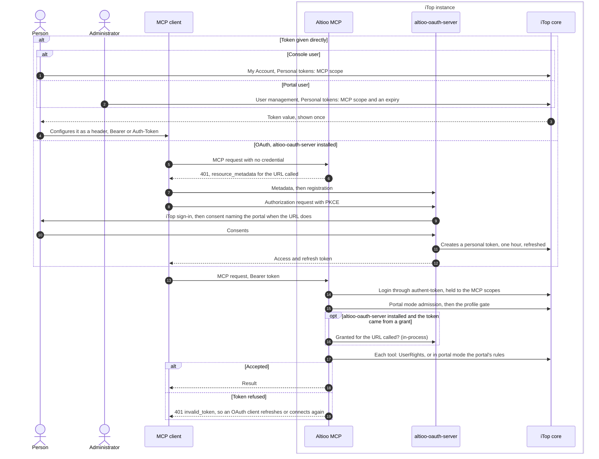
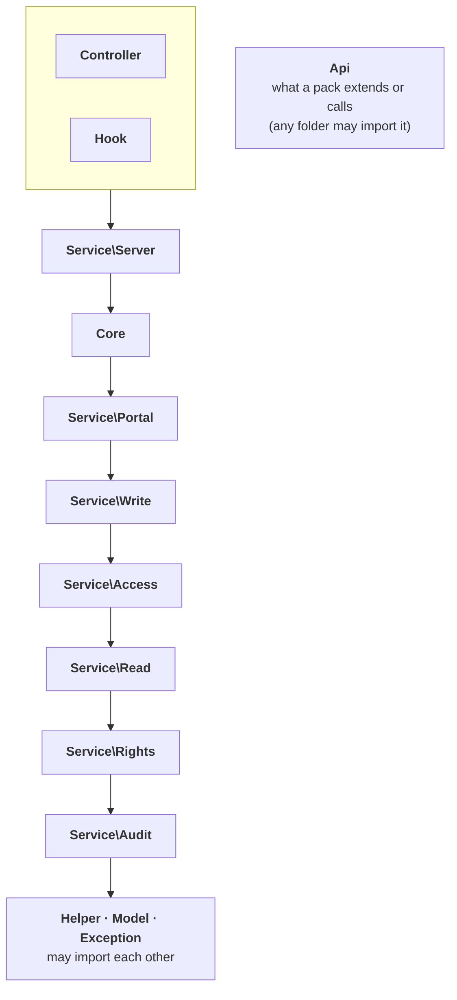

# Architecture — system context and containers

Levels 1 and 2 of the [C4 model](https://c4model.com/): who and what Altioo MCP deals with, one
dynamic view of how a client comes to hold its credential, then the folders under `src/`, the
order they depend on each other in, and the path one request takes through them. It is for
whoever has to place the module in an estate — an approver, an operator, a contributor seeing it
for the first time — before reading the README's reasons for that shape, in
[Why it runs inside iTop](../README.md#why-it-runs-inside-itop).

The diagram names things and points; it does not describe them. Every fact behind a box or an
arrow has its home in a file linked under it, and that file wins when the two disagree.

## Reading it

- **No arrow from Altioo MCP leaves the iTop instance.** Its only outgoing arrows end at iTop
  core and at altioo-oauth-server, both inside the boundary, because the module opens no
  outbound connection ([README, Data flow and privacy](../README.md#data-flow-and-privacy)). The
  one to the OAuth server is a PHP call within the same request, not a network one
  ([ADR 0007](adr/0007-the-connection-names-its-portal.md)). The arrow to the model provider
  starts at the client, and what crosses it is out of this module's reach
  ([SECURITY.md, Threat model](../SECURITY.md#threat-model), "What is out of scope").
- **The client authenticates as an iTop user**, by token, Basic authentication or a proxy in
  `external` mode, and portal mode narrows that to a personal token. Which credential is
  accepted where is in [README, Granting access](../README.md#granting-access).
- **Altioo MCP has no store and no identity of its own.** Accounts, tokens, profiles, rights,
  the datamodel and the change log are iTop core's; the one table the module adds is in
  [README, What the install changes](../README.md#what-the-install-changes).
- **The user is one person in one of two modes.** A console user is served through `UserRights`;
  a portal-only user through what their portal offers, one portal per connection, which the URL
  may name ([ADR 0006](adr/0006-one-tool-surface-the-portal-is-a-policy.md),
  [ADR 0007](adr/0007-the-connection-names-its-portal.md)).
- **The two optional boxes are alternatives** for a client that can only "Connect": the proxy
  must map identity, never pass the upstream token through, and the OAuth server is an
  optional dependency, whose consent names the portal when the URL does
  ([README, Endpoint](../README.md#endpoint);
  [ADR 0003](adr/0003-optional-dependency-on-altioo-oauth-server.md),
  [ADR 0007](adr/0007-the-connection-names-its-portal.md)).
- **Tool packs run inside the same boundary, with the caller's rights**
  ([doc/extending.md](extending.md)).

## How a client gets its credential

A dynamic view of the same elements: the two ways a client comes to hold an iTop token, and what
every call then goes through. OAuth is optional. Without altioo-oauth-server the first way is the
only one, and nothing else changes.

- **The direct way needs no OAuth at all.** Basic authentication works the same way for a
  console user, and a proxy in `external` mode replaces both ways with its own; portal mode
  accepts only a personal token. All of it is in
  [README, Granting access](../README.md#granting-access), and the headers and the `401` in
  [README, Endpoint](../README.md#endpoint).
- **The OAuth way is the OAuth server's to describe** — discovery, registration, consent, token
  lifetime and refresh are in altioo-oauth-server's README,
  [How a connection is made](https://github.com/AltiooBV/altioo-oauth-server#how-a-connection-is-made). What
  this module adds is the `401` that starts it and, with
  [ADR 0007](adr/0007-the-connection-names-its-portal.md), the check that a granted token is
  used only at the URL it was granted for.
- **Every call passes the same gates whichever way the token came**; the list and their order
  are in [doc/security-summary.md](security-summary.md), "The gates a call passes".

## Inside the module — the folders and their order

Level 2: the parts of `src/`. The layout is Combodo's: layer folders, with a feature folder
for each responsibility under `Service/`
([ADR 0015](adr/0015-2-0-lays-out-src-as-itop-does.md)). The arrows run one way, from the top
of the list to the bottom: a class imports its own folder and the ones below it, never one
above. `Api` is outside the order, and any folder may import it.

Top to bottom, as `LayerDependencyTest::LAYERS` ranks them (`Controller` and `Hook` share the
top rank, `Helper`, `Model` and `Exception` the bottom one):

| Folder | Holds |
|---|---|
| `Controller` | The endpoint, `MCPController`, with `CallRequest`, `CallLog` and `MCPResponse`; each check a request passes is one class under `Controller\Gate`, run from one ordered list |
| `Hook` | What iTop calls into: `AuditHousekeeping`, the background process |
| `Service\Server` | Builds the MCP server for one request from the registry (`MCPService`), what a caller is served (`ServedElements`), the warnings about stale settings (`SettingsWarnings`), and its session store |
| `Core` | The core tools, resources, resource templates and prompts, and `ServerInstructions` |
| `Service\Portal` | The portal: `PortalPolicy` and what it is compiled from, `PortalAccess` (the portal's `ObjectAccess`), the description and the rows a list is built from |
| `Service\Write` | Turning a caller's fields into a checked write: `DryRun`, `WritePlan`, `WriteValues`, `DeletionCascade`, `WriteOutcome` and the rules a value must pass (`EditPolicy`, `MentionPolicy`, `FormulaPolicy`, `ExternalKeyPolicy`) |
| `Service\Access` | The question every tool asks of an object: may this caller see it, change it? `ObjectAccess` answers by the console's rules; `DocumentFetch` is the rights half of reading a document |
| `Service\Read` | Reading objects out: `ObjectQuery`, `ObjectSerializer` (with `ObjectGrades`, `UntrustedMarker`, `OutputFields` and `ValueCeilings`), `ObjectHistory`, `DocumentAccess`, `CurrentUserReader`, and the datamodel description (`DatamodelReader`, `ClassCatalog`, `AttributeDescription`, `AttributeFormat`) |
| `Service\Rights` | The rules everything above asks: `TokenScopes`, `AccessPolicy`, `ServedAccess`, `ExclusionPolicy` (with `ExclusionSettings` and `ExclusionSearches`), `SecretPolicy`, the barrier on access-granting classes (`AccessGrants` and its parts) and the grading of a class's rights |
| `Service\Audit` | The audit trail: `AuditRetention`, `ChangeSummary`, `ReadSummary` |
| `Helper`, `Model`, `Exception` | Small stateless utilities and per-request facts (`Settings`, `MCPLog`, `PortalMode`, `ObjectId`, `MCPHttp`), the value object `MCPResult`, and the exceptions |
| `Api` | What a pack extends or calls: the abstract elements, `iMCPServiceProvider`, `MCPRegistry`, `MCPExtensionCollector`, `ToolOutput`, `ResourceOutput`, `ChangeTracking`, `MCPModule` and `Testing\ElementContract`. iTop has no equivalent folder |

### How one request flows

The arrows above are import rules; this is the order things happen in, for a call that
succeeds.

1. **`Controller\MCPController`** receives the request and runs `Controller\Gate`'s gates in the
   order of its `GATES` list: `PreflightGate`, `HostIsServedGate`, `BodyIsJsonGate`,
   `CredentialPresentedGate`, `TokenNotAParameterGate`, `LoginGate`, `McpProfileGate`,
   `TokenLoginAccountedForGate`, `TokenAudienceGate`. Each lets the request go on or answers
   it. The list and why it is in that order are in
   [doc/security-summary.md](security-summary.md), "The gates a call passes". `PortalAdmission`,
   which `LoginGate` uses, calls `Service\Portal\PortalAccess::Enter()` for a portal-only
   user.
2. The controller decides the caller's `Service\Rights\AccessPolicy`, remembers it and the
   token's identity, and drops the credential.
3. **`Service\Server\MCPService::run()`** builds the MCP server for the request: it takes the
   elements `Api\MCPRegistry` holds, the core ones from `Core\CoreExtensions` and a pack's from
   its `iMCPServiceProvider`, and leaves out those the operator disabled or the caller's
   `AccessPolicy` does not serve.
4. The server hands the call to a **`Core`** tool, or to a pack's tool extending `Api\AbstractMCPTool`.
   The tool states its own security checks in its own source
   ([ADR 0014](adr/0014-a-tool-keeps-its-security-checks-in-its-own-source.md)).
5. The tool asks **`Service\Access\ObjectAccess::Current()`** whether the caller may see or
   change the object. That is `ObjectAccess` itself, the console's rules through `UserRights`,
   or `PortalAccess` when the request entered portal mode; with nothing entered in portal mode
   it refuses rather than answering as the console.
6. A read goes through `Service\Read` (`ObjectQuery`, `ObjectSerializer`); a write through
   `Service\Write\DryRun` and the write classes beside it, which check each value, simulates by default and applies the
   change only when asked. Both ask `Service\Rights` what is excluded, secret or barred
   (`ExclusionPolicy`, `SecretPolicy`, `AccessGrants`).
7. `Controller\MCPResponse` writes the answer, and `Controller\CallLog` records the audit row,
   whose summaries come from `Service\Audit` (`ChangeSummary`, `ReadSummary`). Later,
   iTop's cron calls `Hook\AuditHousekeeping`, which applies `Service\Audit\AuditRetention`.

### Which test holds what

- **The order** is `LayerDependencyTest` (`tests/php-unit-tests/Unit/`). It reads each file's
  imports and same-namespace references from the PHP tokens and fails on a class importing a
  layer above its own. Its baseline of accepted violations is empty, and an entry is removed
  in the commit that fixes it.
- **The `@api` surface** is `PublicSurfaceTest`: a class carries `@api` only under `src/Api/`
  or in its `EXTRA_SURFACE`, and every other class says `@internal`.
  [doc/extending.md](extending.md) names the four classes outside `Api`.
- **The version** is `ModuleMetadataTest`; the tool packs' contract is `Api\Testing\ElementContract`.

## What it leaves out

- **Components** — the classes inside a folder. The code under `src/` is the reference; the
  folders above are as far down as this page goes.
- **Deployment** — the web server, the `.htaccess` / `web.config` pair, the compiled
  `env-production/` copy: [README, Endpoint](../README.md#endpoint) and
  [SECURITY.md, Hardening the deployment](../SECURITY.md#hardening-the-deployment).
- **Repository tooling** — CI, the local runner, the proposed agent evaluation harness
  ([ADR 0008](adr/0008-agent-behaviour-is-tested-with-a-model.md)). None of it is part of an
  installed instance.

## Keeping it true

Change the diagrams in the same pull request as the change that alters them: a new folder or a
change to the layer order (which `LayerDependencyTest::LAYERS` holds), a new kind of client
credential, a new optional dependency, a new actor, a new check a call passes. **An arrow
from Altioo MCP that leaves the iTop boundary is the one change that would make the README's
privacy section false**, so a pull request adding one fixes both, and says so in its
description.
