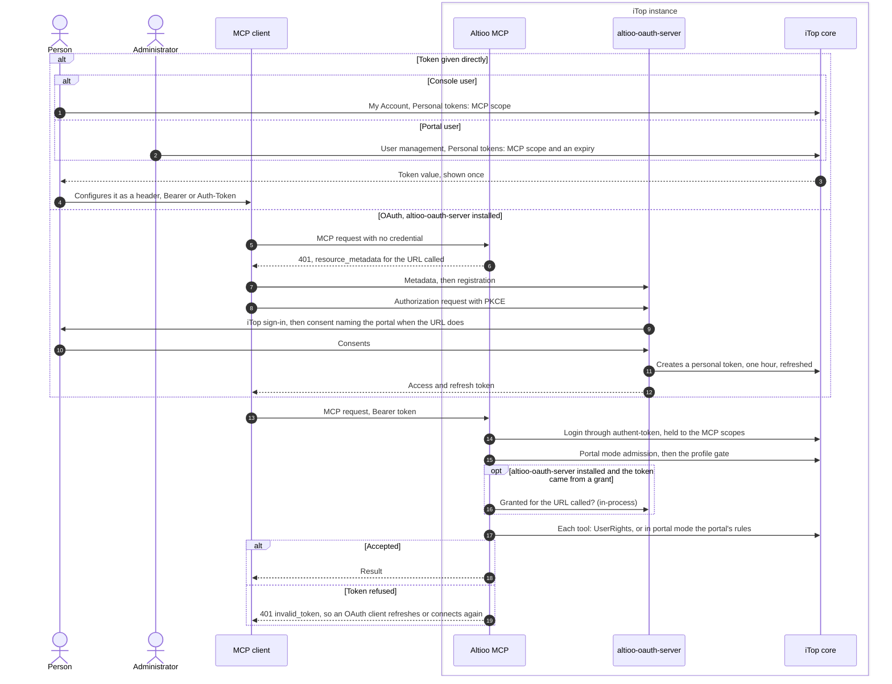
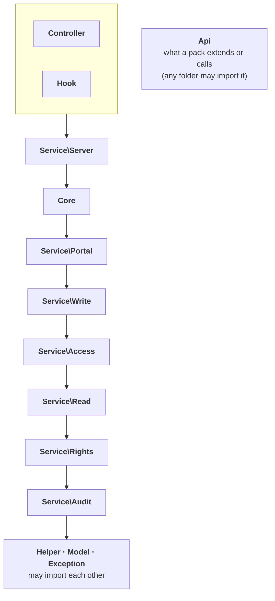
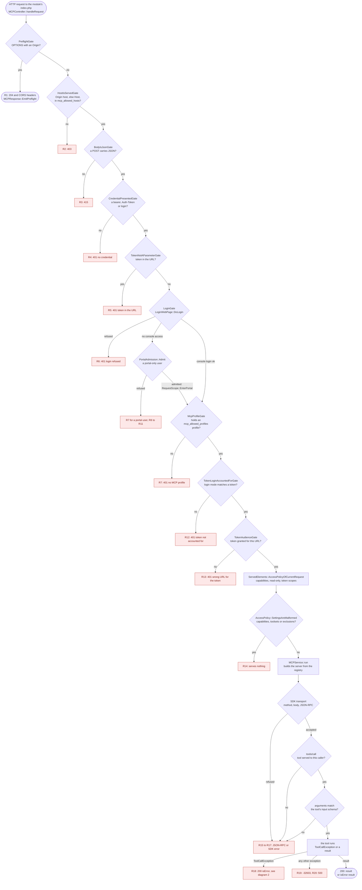
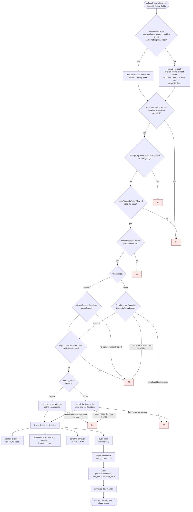
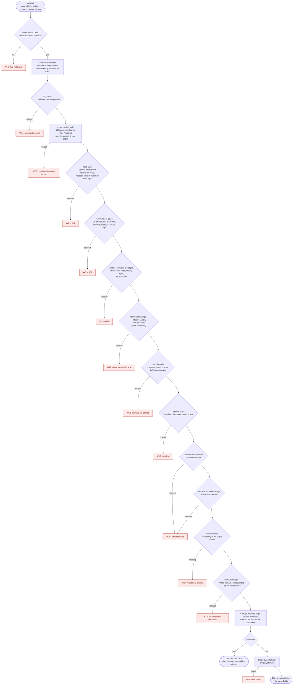
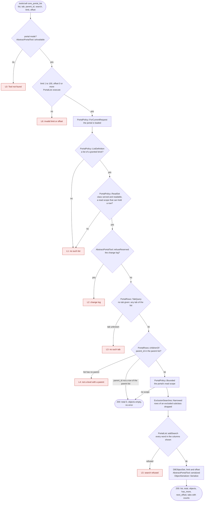

# Architecture — system context and containers

Levels 1 and 2 of the [C4 model](https://c4model.com/): who and what Altioo MCP deals with, one
dynamic view of how a client comes to hold its credential, then the folders under `src/`, the
order they depend on each other in, and the path one request takes through them. It is for
whoever has to place the module in an estate — an approver, an operator, a contributor seeing it
for the first time — before reading the README's reasons for that shape, in
[Why it runs inside iTop](../README.md#why-it-runs-inside-itop).

The diagram names things and points; it does not describe them. Every fact behind a box or an
arrow has its home in a file linked under it, and that file wins when the two disagree.

## Reading it

- **No arrow from Altioo MCP leaves the iTop instance.** Its only outgoing arrows end at iTop
  core and at altioo-oauth-server, both inside the boundary, because the module opens no
  outbound connection ([README, Data flow and privacy](../README.md#data-flow-and-privacy)). The
  one to the OAuth server is a PHP call within the same request, not a network one
  ([ADR 0007](adr/0007-the-connection-names-its-portal.md)). The arrow to the model provider
  starts at the client, and what crosses it is out of this module's reach
  ([SECURITY.md, Threat model](../SECURITY.md#threat-model), "What is out of scope").
- **The client authenticates as an iTop user**, by token, Basic authentication or a proxy in
  `external` mode, and portal mode narrows that to a personal token. Which credential is
  accepted where is in [README, Granting access](../README.md#granting-access).
- **Altioo MCP has no store and no identity of its own.** Accounts, tokens, profiles, rights,
  the datamodel and the change log are iTop core's; the one table the module adds is in
  [README, What the install changes](../README.md#what-the-install-changes).
- **The user is one person in one of two modes.** A console user is served through `UserRights`;
  a portal-only user through what their portal offers, one portal per connection, which the URL
  may name ([ADR 0006](adr/0006-one-tool-surface-the-portal-is-a-policy.md),
  [ADR 0007](adr/0007-the-connection-names-its-portal.md)).
- **The two optional boxes are alternatives** for a client that can only "Connect": the proxy
  must map identity, never pass the upstream token through, and the OAuth server is an
  optional dependency, whose consent names the portal when the URL does
  ([README, Endpoint](../README.md#endpoint);
  [ADR 0003](adr/0003-optional-dependency-on-altioo-oauth-server.md),
  [ADR 0007](adr/0007-the-connection-names-its-portal.md)).
- **Tool packs run inside the same boundary, with the caller's rights**
  ([doc/extending.md](extending.md)).

## How a client gets its credential

A dynamic view of the same elements: the two ways a client comes to hold an iTop token, and what
every call then goes through. OAuth is optional. Without altioo-oauth-server the first way is the
only one, and nothing else changes.

- **The direct way needs no OAuth at all.** Basic authentication works the same way for a
  console user, and a proxy in `external` mode replaces both ways with its own; portal mode
  accepts only a personal token. All of it is in
  [README, Granting access](../README.md#granting-access), and the headers and the `401` in
  [README, Endpoint](../README.md#endpoint).
- **The OAuth way is the OAuth server's to describe** — discovery, registration, consent, token
  lifetime and refresh are in altioo-oauth-server's README,
  [How a connection is made](https://github.com/AltiooBV/altioo-oauth-server#how-a-connection-is-made). What
  this module adds is the `401` that starts it and, with
  [ADR 0007](adr/0007-the-connection-names-its-portal.md), the check that a granted token is
  used only at the URL it was granted for.
- **Every call passes the same gates whichever way the token came**; the list and its order are
  `Controller\MCPController::GATES`, and "How one request flows" below says what each answers.
  [doc/security-summary.md](security-summary.md), "The gates a call passes", is the operator's view
  of what the gates and the tools together enforce.

## Inside the module — the folders and their order

Level 2: the parts of `src/`. The layout is Combodo's: layer folders, with a feature folder
for each responsibility under `Service/`
([ADR 0015](adr/0015-2-0-lays-out-src-as-itop-does.md)). The arrows run one way, from the top
of the list to the bottom: a class imports its own folder and the ones below it, never one
above. `Api` is outside the order, and any folder may import it.

Top to bottom, as `LayerDependencyTest::LAYERS` ranks them (`Controller` and `Hook` share the
top rank, `Helper`, `Model` and `Exception` the bottom one):

| Folder | Holds |
|---|---|
| `Controller` | The endpoint, `MCPController`, with `CallRequest`, `CallLog` and `MCPResponse`; each check a request passes is one class under `Controller\Gate`, run from one ordered list |
| `Hook` | What iTop calls into: `AuditHousekeeping`, the background process |
| `Service\Server` | Builds the MCP server for one request from the registry (`MCPService`), opens and closes the request's state (`RequestScope`), what a caller is served (`ServedElements`), the warnings about stale settings (`SettingsWarnings`), and its session store |
| `Core` | The core tools, resources, resource templates and prompts, and `ServerInstructions` |
| `Service\Portal` | The portal: `PortalPolicy` and what it is compiled from, `PortalAccess` (the portal's `ObjectAccess`), the description and the rows a list is built from |
| `Service\Write` | Turning a caller's fields into a checked write: `DryRun`, `WritePlan`, `WriteValues`, `DeletionCascade`, `WriteOutcome` and the rules a value must pass (`EditPolicy`, `MentionPolicy`, `FormulaPolicy`, `ExternalKeyPolicy`) |
| `Service\Access` | The question every tool asks of an object: may this caller see it, change it? `ObjectAccess` answers by the console's rules; `DocumentFetch` is the rights half of reading a document |
| `Service\Read` | Reading objects out: `ObjectQuery`, `ObjectSerializer` (with `ObjectGrades`, `UntrustedMarker`, `OutputFields` and `ValueCeilings`), `ObjectHistory`, `DocumentAccess`, `CurrentUserReader`, and the datamodel description (`DatamodelReader`, `ClassCatalog`, `AttributeDescription`, `AttributeFormat`) |
| `Service\Rights` | The rules everything above asks: `TokenScopes`, `AccessPolicy`, `ServedAccess`, `ExclusionPolicy` (with `ExclusionSettings` and `ExclusionSearches`), `SecretPolicy`, the barrier on access-granting classes (`AccessGrants` and its parts) and the grading of a class's rights |
| `Service\Audit` | The audit trail: `AuditRetention`, `ChangeSummary`, `ReadSummary` |
| `Helper`, `Model`, `Exception` | Small stateless utilities and per-request facts (`Settings`, `MCPLog`, `PortalMode`, `ObjectId`, `MCPHttp`), the value object `MCPResult`, and the exceptions |
| `Api` | What a pack extends or calls: the abstract elements, `iMCPServiceProvider`, `MCPRegistry`, `MCPExtensionCollector`, `ToolOutput`, `ResourceOutput`, `ChangeTracking`, `MCPModule` and `Testing\ElementContract`; the classes beside it that a pack may call are on the `@api` surface below. iTop has no equivalent folder |

### How one request flows

The arrows above are import rules; this is the order things happen in, for a call that
succeeds.

1. **`Controller\MCPController`** receives the request and runs `Controller\Gate`'s gates in the
   order of its `GATES` list: `PreflightGate`, `HostIsServedGate`, `BodyIsJsonGate`,
   `CredentialPresentedGate`, `TokenNotAParameterGate`, `LoginGate`, `McpProfileGate`,
   `TokenLoginAccountedForGate`, `TokenAudienceGate`. Each lets the request go on or answers
   it. The list is the code's (`MCPController::GATES`), the order is the security property, and
   the reason is on `Controller\Gate\iGate`: each gate stands where it does because of a side effect
   it must come before. What each one answers is the R1–R13 rows of the table under
   [Troubleshooting](#1-the-request-path). `PortalAdmission`,
   which `LoginGate` uses, calls `Service\Server\RequestScope::EnterPortal()` for a portal-only
   user, which sets the portal and the access that answers for it together.
2. The controller decides the caller's `Service\Rights\AccessPolicy`, opens the request with it
   (`RequestScope::Open()` remembers it and the token's identity), and drops the credential.
3. **`Service\Server\MCPService::run()`** builds the MCP server for the request: it takes the
   elements `Api\MCPRegistry` holds, the core ones from `Core\CoreExtensions` and a pack's from
   its `iMCPServiceProvider`, and leaves out those the operator disabled or the caller's
   `AccessPolicy` does not serve.
4. The server hands the call to a **`Core`** tool, or to a pack's tool extending `Api\AbstractMCPTool`.
   The tool states its own security checks in its own source
   ([ADR 0014](adr/0014-a-tool-keeps-its-security-checks-in-its-own-source.md)).
5. The tool asks **`Service\Access\ObjectAccess::Current()`** whether the caller may see or
   change the object. That is `ObjectAccess` itself, the console's rules through `UserRights`,
   or `PortalAccess` when the request entered portal mode; with nothing entered in portal mode
   it refuses rather than answering as the console.
6. A read goes through `Service\Read` (`ObjectQuery`, `ObjectSerializer`); a write through
   `Service\Write\DryRun` and the write classes beside it, which check each value, simulates by default and applies the
   change only when asked. Both ask `Service\Rights` what is excluded, secret or barred
   (`ExclusionPolicy`, `SecretPolicy`, `AccessGrants`).
7. `Controller\MCPResponse` writes the answer, and `Controller\CallLog` records the audit row,
   whose summaries come from `Service\Audit` (`ChangeSummary`, `ReadSummary`). Later,
   iTop's cron calls `Hook\AuditHousekeeping`, which applies `Service\Audit\AuditRetention`.
8. **`Service\Server\RequestScope::Close()`** forgets every per-request slot, whichever way the
   request ended: the controller calls it in a `finally`, after the audit row, as the audit task
   does and a test's teardown. The state stays static, as iTop's helpers keep theirs;
   `RequestStateTest` fails for a static property that `Close()` does not clear and that is not
   listed as registration for the life of the process.

### Which test holds what

- **The order** is `LayerDependencyTest` (`tests/php-unit-tests/Unit/`). It reads each file's
  imports and same-namespace references from the PHP tokens and fails on a class importing a
  layer above its own. Its baseline of accepted violations is empty, and an entry is removed
  in the commit that fixes it.
- **The `@api` surface** ([ADR 0016](adr/0016-what-the-core-tools-use-is-public.md)) is
  `PublicSurfaceTest`: a class carries `@api` under `src/Api/`, when an element under `src/Core/`
  depends on it, or when a public signature of one of those names it as a type; every other class
  says `@internal`. The test fails when the surface and the elements' dependencies disagree, and
  [doc/extending.md](extending.md) lists what a pack may call.
- **A tool's security checks** (ADR 0014: the barrier, the change-log reservation, the gate order of the
  controller, the policies before every value conversion) are contract tests that read PHP tokens through
  `Support\SourceCalls`, resolving `X::m(` through the file's `use` lines, so a comment or a string that
  names a call does not count and a rename needs no edit.
- **The version** is `ModuleMetadataTest`; the tool packs' contract is `Api\Testing\ElementContract`.

## Troubleshooting: where a request stops

Four flowcharts for whoever has a client reporting an error and has to find which step said it.
Each stop is a red box with a number; the table under the diagram gives, for that number, what the
client sees, the class and method that produced it, and what the operator finds in `log/error.log`.
The order of the gates is `Controller\MCPController::GATES` and the reason for it is on
`Controller\Gate\iGate`; the folders the
classes live in are in [Inside the module](#inside-the-module--the-folders-and-their-order); this
section does not repeat either. The texts are copied from the source of this branch, and
the source wins where they differ. Names carry no namespace: `Controller\Gate\LoginGate` is written
`LoginGate`, and the folder is in the first column of the list under
[How one request flows](#how-one-request-flows).

A refusal from a gate is **not** a JSON-RPC error. It is a plain JSON body
`{"code": 1, "message": "…", "mcpMethod": "exceptions", …}` with the HTTP status in the table
(`MCPResponse::OutputJsonResultException`, `MCPController::buildErrorResult`), and a `401`
adds `WWW-Authenticate: Bearer realm="iTop MCP"`, with `error="invalid_token"` and
`resource_metadata="…"` where the table says so. Everything from step 14 on is the MCP SDK's own
JSON-RPC, or a tool's result.

### 1. The request path

Where the diagram says "refused", the row is in the table. A row carries the number of the box it
belongs to, so a client's symptom is found by the text or the status in the first column.

| # | The client sees | At step | Produced by |
|---|---|---|---|
| R1 | `204`, CORS headers, no body. Not a refusal: the browser's preflight | `PreflightGate` | `PreflightGate::Check` → `MCPResponse::EmitPreflight` |
| R2 | `403`, `{"code": 2, "message": "This host is not served by the MCP endpoint."}`. Log: *Refused an MCP request: neither its Origin (…) nor its Host (…) is in 'mcp_allowed_hosts'. Set that module parameter to the hostname this instance is served under.* The name that was refused is only in the log | `HostIsServedGate` | `HostIsServedGate::Check` (`MCPHttp::IsAllowedHost`, `Settings::GetAllowedHosts`); status by `MCPController::buildErrorResult` |
| R3 | `415`, code `2`, *A POST to the MCP endpoint must carry Content-Type: application/json.* | `BodyIsJsonGate` | `BodyIsJsonGate::Check` (`MCPHttp::IsJsonMediaType`) |
| R4 | `401`, code `1`, *No credential was sent. The MCP endpoint needs one on every request: a bearer token in the Authorization header, an Auth-Token header, or a login. A browser session does not count.* The challenge carries `resource_metadata` when an OAuth resource is configured | `CredentialPresentedGate` | `CredentialPresentedGate::Check` (`MCPHttp::CarriesACredential`); challenge by `MCPResponse::BearerChallenge` |
| R5 | `401`, *Send the token in the Authorization header (Bearer) or the Auth-Token header. A token passed as the auth_token request parameter is refused: a URL is written to access logs.* Log: *Refused an MCP request carrying auth_token as a request parameter.* | `TokenNotAParameterGate` | `TokenNotAParameterGate::Check` (`MCPHttp::CarriesATokenAsAParameter`) |
| R6 | `401` with `error="invalid_token"`: *The token was not accepted: it is unknown, has expired or been revoked, or carries no MCP scope. Refresh it, or connect again.* For a login and password instead of a token: *The login or password was not accepted.* An unexpected iTop answer reads *Unknown authentication error (retCode=…)* | `LoginGate` | `LoginGate::Check` → `AuthRefusal::CreateAuthException` → `AuthRefusal::createWrongCredentialsException` |
| R7 | `401`, *This user is not authorized to use the MCP services. (By default, the profile "MCP Services User" or "Administrator" is required; the profiles this instance accepts are set by the mcp_allowed_profiles module parameter.)* Log: *Refused an MCP request: '<user>' holds none of the profiles in 'mcp_allowed_profiles' (…)*, saying when the list is empty | `McpProfileGate`, and `PortalAdmission` for a portal-only user without the profile | `McpProfileGate::Check` (`Settings::IsAccessRestricted`, `AllowedProfiles::UserHasMCPProfile`) → `AuthRefusal::createProfileException` |
| R8 | `401`, *This user has no access to the iTop console. The MCP services serve what the console serves, so a portal-only user cannot reach them - the account needs a profile granting console access in addition to whatever lets it through the MCP gate, or an administrator has to serve its portal in portal mode (the mcp_portals module parameter).* Log: either *the URL names the portal 'x', which '<user>' may not enter or 'mcp_portals' does not serve*, or *'<user>' is allowed into none of the portals in 'mcp_portals'* | `LoginGate` → `PortalAdmission`: `mcp_portals` is empty, `portal_id` names a portal the user may not enter or the setting does not serve, or no portal fits | `PortalAdmission::Admit` (`PortalMode::Choose`, reason `PortalMode::REFUSED_NO_SERVED_PORTAL`) → `AuthRefusal::createNoConsoleAccessException`; audit row by `CallLog::AuditAdmissionRefusal` |
| R9 | `401`, *A user without console access is served with a token only. Send it in the Authorization header (Bearer) or the Auth-Token header.* | `PortalAdmission`, a portal-only user who did not log in with a token | `PortalAdmission::Admit`, reason `PortalMode::REFUSED_NOT_A_TOKEN` |
| R10 | `401`, *In portal mode a token must expire within N days. Ask for a personal token with an expiry date no later than YYYY-MM-DD, or set one on this token.* Log names `mcp_portal_token_max_days` | `PortalAdmission`, token without an expiry or too far off | `PortalAdmission::Admit`, reason `PortalMode::REFUSED_TOKEN_UNBOUNDED` (`PortalMode::TokenIsBounded`, `Settings::GetPortalTokenMaxDays`) |
| R11 | `401`, *This account is linked to no contact, which an iTop portal requires. Ask an administrator to link it to the person it belongs to.* | `PortalAdmission` | `PortalAdmission::Admit`, reason `PortalMode::REFUSED_NO_CONTACT` |
| R12 | `401`, *Send the token in the Authorization header (Bearer) or the Auth-Token header.* Log: *iTop logged it in under login mode '…' with a token this module was not shown, so the token's scopes could not be applied.* | `TokenLoginAccountedForGate` | `TokenLoginAccountedForGate::Check` (`TokenScopes::LoginIsAccountedFor`) |
| R13 | `401`, *This token was granted for another URL of this endpoint, such as another portal's. Connect again from this URL to consent to it.* Log names the OAuth resource the token was granted for and the URL called ([ADR 0007](adr/0007-the-connection-names-its-portal.md)). Only when altioo-oauth-server is installed | `TokenAudienceGate` | `TokenAudienceGate::Check` (`OAuthResource::CalledEndpointUrl`) |
| R14 | **No error.** The client authenticates, then finds no tools, resources or prompts, and `tools/call` answers as R15. Log, once per request: *Itop configuration parameter for exclusions: … Nothing is served to anyone until it is corrected.* (or *Itop configuration parameter 'mcp_capabilities' should be an array instead of …. Nothing is served until it is corrected.*, and the same for `mcp_enabled_toolsets`). This is how a setting that cannot be honoured stops the endpoint ([ADR 0012](adr/0012-this-channel-can-exclude-classes-and-attributes.md), Amendment 2) | `ServedElements::AccessPolicyOfCurrentRequest` | `AccessPolicy::SettingsAreMalformed` (`Settings::AccessListsAreMalformed`, `ExclusionPolicy::IsMalformed`) → `AccessPolicy::Nothing`; the log line by `ExclusionPolicy::state` |
| R15 | JSON-RPC `-32602`, *Tool not found: "name".* The tool is unregistered, or hidden from this caller: in portal mode, not `PortalAware` or a pack's element the operator did not list in `mcp_portal_extensions` ([ADR 0017](adr/0017-a-pack-element-may-serve-the-portal-when-the-operator-lists-it.md)), a toolset or grade the policy or token does not serve, named in the disabled list, or a required profile the caller lacks. Also `-32602` *Invalid parameters for tool 'name': …* for an argument the input schema refuses | `MCPService::registerTools` leaves it out; the SDK answers | `ServedElements::isHidden`; `Mcp\Server\Handler\Request\CallToolHandler::handle` (in `vendor/mcp/sdk`) |
| R16 | The SDK's own transport answers: `-32700` parse error (HTTP `400` on the stateless leg), `405` *Method Not Allowed* with `Allow: POST, DELETE, OPTIONS`, `413` for a body over the limit, `400` for a bad `Mcp-Session-Id` or a header that does not match the body (`-32020`). | the SDK transport | `MCPService::run`, `MCPService::middleware`; `Mcp\Server\Transport\StreamableHttpTransport` (in `vendor/mcp/sdk`) |
| R17 | `403`, `Content-Type: text/plain`, body *Forbidden: Invalid Host header.* or *Forbidden: Invalid Origin header.* Not skipped unless `mcp_allowed_hosts` holds `*` | the SDK's `DnsRebindingProtectionMiddleware`, a second check after `HostIsServedGate` | `MCPService::middleware`; `Mcp\Server\Transport\Http\Middleware\DnsRebindingProtectionMiddleware` (in `vendor/mcp/sdk`) |
| R18 | HTTP `200`, JSON-RPC success, `result.isError: true`, the tool's own text. The audit row says only *The tool refused the call*; the text is kept at `log_mcp_level` `debug` | the tool | A tool throws `Mcp\Exception\ToolCallException`; the audit row is made by `MCPResponse::buildResultFromBody`. For `core_object_get` see [diagram 2](#2-what-core_object_get-checks) |
| R19 | JSON-RPC `-32603`, *Error while executing tool* | the tool: an exception that is not a `ToolCallException`, which is a bug in the tool | `CallToolHandler::handle` (in `vendor/mcp/sdk`) |
| R20 | HTTP `500`, `{"code": 100, "message": "The MCP request could not be completed. Server log reference: <ref>"}`. Log: *[<ref>] Unhandled <Class>: …*. An unexpected failure before or after the SDK answered | `MCPController::serve`, the `catch (Throwable)` | `MCPController::buildErrorResult`, `ErrorReport::NewReference`, `MCPResponse::OutputJsonResultException` |

Two things the diagram cannot show:

- **R2 and R17 are two host checks** on the same `mcp_allowed_hosts`, with different rules, so a request
  that passes the first can still fail the second. `HostIsServedGate` looks at the `Origin` host and,
  with none, the `Host`; the SDK's middleware also compares the origin with the host. A `403` whose body
  is plain text, not `{"code": 2, …}`, came from the middleware.
- **Console and portal share the path as far as `LoginGate`.** Only a user the console refuses for lack of console
  access (`LoginWebPage::EXIT_CODE_PORTALUSERNOTAUTHORIZED`) is sent to `PortalAdmission`; a console
  user never reaches it. What changes after it is the object access every tool asks
  (`ObjectAccess::Current`), which diagram 2 follows.

### 2. What `core_object_get` checks

[ADR 0014](adr/0014-a-tool-keeps-its-security-checks-in-its-own-source.md) keeps the checks in the
tool's own source, so every branch below starts at `Core\Tools\ObjectGet::execute`, in the order it
makes them. The settings behind the exclusion boxes are in
[ADR 0012](adr/0012-this-channel-can-exclude-classes-and-attributes.md) and
[ADR 0013](adr/0013-an-exempt-profile-is-served-what-is-excluded.md). Portal mode is
[ADR 0006](adr/0006-one-tool-surface-the-portal-is-a-policy.md): the same tool with
`PortalAccess` in place of `ObjectAccess`.

Every refusal here is `HTTP 200` with `result.isError: true` and the text below as the tool's text
(R18 above). The **same sentence** answers an unknown class, an excluded class and a class the
account may not read, and the same *Object … not found.* answers a missing object, one the caller
may not see, one of an excluded class and one outside the portal's scope. That is deliberate: an
answer that differed would say which classes and objects exist
([ADR 0012](adr/0012-this-channel-can-exclude-classes-and-attributes.md), "Excluded is absent").

| # | The client sees | Step | Produced by |
|---|---|---|---|
| S1 | Console: *Unknown class 'X': either this datamodel has no such class, or this account may not read it. iTop reserves its rights model, its credentials and its automation for administrators, so if you named one of those, no profile you can be granted changes this. core_class_list shows the classes you can reach.* Portal: *Unknown class 'X': the portal does not offer it. core_class_list shows the classes it offers you.* A value that is not shaped like a class name gets *That is not a class name: a class name is letters, digits and underscores, and does not start with a digit. …* | class unknown or **excluded** (`ExclusionPolicy::Serves`), or the account has no read right on the class (`UserRights::IsActionAllowed`) | `ObjectGet::execute`; text by `ClassRefusal::Unreadable`; exclusion by `ExclusionPolicy::Serves` → `ExclusionPolicy::ExcludesClass` |
| S2 | *Class 'X' is the change log, which is served by core_object_history only.* | the change log classes | `ObjectGet::execute`; `ChangeLogReservation::IsReserved`, text `ChangeLogReservation::RESERVED_REFUSAL` |
| S3 | *This request is in portal mode, but its portal access was never set: nothing is served.* A request in portal mode refuses rather than answers by the console's rules | no portal access for a portal request | `ObjectAccess::Current` (as `MCPPortalException`, turned into the tool's text by `AbstractMCPTool::portalRefusal`) |
| S4 | *Object X::id not found.* Whatever the reason: no such object, no read right on this object, a subclass the caller may not read, an object of an excluded class or one filed under one (an `Attachment` whose host is excluded), outside the portal's read scope, or the change log | the object gate, before the object is read | console `ObjectAccess::Readable` (`UserRights::IsActionAllowed`, `ExclusionPolicy::ExcludesClass`, `ExclusionSearches::IsFiledUnderExcluded`); portal `PortalAccess::Readable` (`ChangeLogReservation::IsReserved`, then `PortalPolicy::Readable`); message thrown in `ObjectGet::execute` |
| S5 | *Unknown attribute 'code' on class 'C'. Call core_class_schema for the attribute codes of the class.* (plural for several). For a code that is excluded, not on the portal's form, or not an attribute at all, the text is the same | `output_fields` names something the caller cannot have | console `OutputFields::ParseFieldList` (`ExclusionPolicy::ExcludesAttribute`); portal `ObjectGet::fieldsOf`; text by `OutputFields::UnknownAttributes` |
| S6 | *Could not read portal '<id>'* or *Could not read the '<mode>' form of C in portal '<id>'*, followed by *Server log reference: <ref>* and a pointer to the audit row. The log has the cause. [ADR 0001](adr/0001-portal-mode-bricks-bound-discovery.md): a portal that cannot be read serves nothing, never the scopes alone | portal configuration | `PortalLoader`, `PortalForms::Fields`, `PortalPolicy`, through `ErrorReport::OpaqueFailure`; `AbstractMCPTool::portalRefusal` |

What a successful answer leaves out or adds, with no error and no marker in the answer:

| In the answer | Rule | Produced by |
|---|---|---|
| An excluded attribute is **absent**, for a named field list as for "all" | [ADR 0012](adr/0012-this-channel-can-exclude-classes-and-attributes.md) | `ObjectSerializer::Serialize` → `ExclusionPolicy::ExcludesAttribute` |
| An attribute the account may not read is absent; one graded "depends" is asked again on this object | iTop's `UserRights` | `ObjectSerializer::MayReadAttribute` |
| A sensitive attribute is `*****`, converted before its value is read | password and secret types, and the outbound tokens `AccessGrantFamilies` names | `ObjectSerializer::Value`, `ObjectSerializer::IsSensitive` (`AccessGrantFamilies::IsOutboundSecret`) |
| Console: every attribute the above leaves. **Portal: only the fields the portal's view form shows for this object**, with the friendly name of an external key | the console's form governs *writes* ([ADR 0004](adr/0004-writes-follow-the-console-form.md)), not reads | `ObjectAccess::VisibleFields` (`null`: all); `PortalAccess::VisibleFields` (`PortalPolicy::Fields`, `PortalAccess::Shown`) |
| `audit`: created and last changed, by whom. Not in portal mode | | `ObjectAccess::Attribution`; `PortalAccess::Attribution` answers `null` |
| `rights` and `stimuli`: what may be done to *this* object now. In portal mode every gate but `modify` is `no`, `modify` needs the portal's write scope, and the stimuli are the portal's | | `ObjectAccess::RightsOn`, `StimuliOn`; `PortalAccess::RightsOn`, `StimuliOn` |
| `attachments`, `may_attach`, `settable_fields`. Portal only; the console lists `Attachment` objects through `core_object_search_by_class` | [ADR 0011](adr/0011-portal-mode-reads-and-adds-attachments.md) | `ObjectAccess::Extras` (empty); `PortalAccess::Extras` → `PortalAccess::AttachmentsOf` |
| `untrusted_text`: which text came from outside the organisation | | `UntrustedMarker::UntrustedText` |

The exemption (box at the top) is decided from the account that authenticated, outside portal mode
(`ExclusionSettings::holdsOneOf`, called from `ExclusionPolicy::state`); with it, `state()` hands
back empty lists, so `ExcludesClass` and `ExcludesAttribute` answer no and the rest of the path is
unchanged. The call is marked on its audit row (`CallLog::LogIfConfigured`, column `exempt`).

### 3. What the write tools check

`core_object_update`, `core_object_create` and `core_object_apply_stimulus` make the same checks
in nearly the same order, each in its own source
([ADR 0014](adr/0014-a-tool-keeps-its-security-checks-in-its-own-source.md)), so they are one
chart; the box says where one of them differs. A field is held to the **console's form** in the
object's state ([ADR 0004](adr/0004-writes-follow-the-console-form.md)) and, in portal mode, to the
**portal's form** as well
([ADR 0005](adr/0005-portal-mode-writes-follow-the-portal-form.md)); the schema `core_class_schema`
returns is not the test. The tools are served in both modes
([ADR 0006](adr/0006-one-tool-surface-the-portal-is-a-policy.md)). `core_object_delete` and the bulk
tools are not `PortalAware`, so portal mode does not serve them (R15).

Every row is `HTTP 200` with `result.isError: true` and this text (R18), except W19. Rows that
speak of a class or an object use the same words as diagram 2, so that an excluded class and an
unknown one cannot be told apart.

| # | The client sees | Step | Produced by |
|---|---|---|---|
| W19 | The write tool is **not there**: `tools/list` omits it and a call gets `-32602` *Tool not found: "core_object_update".* No refusal text exists for a read-only instance (`mcp_read_only`), a token without a write grade, or a toolset that is not served | `ServedElements::isHidden` → `AccessPolicy::allowsTool`; the policy is decided by `ServedElements::AccessPolicyOfCurrentRequest` | see R15 |
| – | **Nothing changed and no error:** `simulated: true`. `simulate` defaults to `true`; a token carrying the `MCP-advisory` scope rehearses every write whatever `simulate` says | `DryRun::Simulated` (`AccessPolicy::isAdvisory`, `AccessPolicy::FromScopes`, `MCPContext::SCOPE_ADVISORY`) | the three `execute()` methods |
| W20 | Create in portal mode: *In portal mode a creation runs one of the portal's create actions: pass action, from core_class_list, and from_id when it starts from an object.* · *The portal offers no such create action. Call core_class_list for the ones it offers.* · *This create action starts from nothing: leave from_id out.* · *This create action starts from a <kind>: from_id must be one listed by core_portal_list on <list>.* (the id is not a row of the action's `from_list`, or of a list above it) · *The portal does not let you create what this action creates.* In the console, `action` or `from_id` gives *action and from_id are a portal's create action, and this connection is not served in portal mode: pass class and fields.* | the start of `ObjectCreate::execute` | `ObjectAccess::Prepared`; portal `PortalAccess::Prepared` → `actionOf`, `startingPoint` (`PortalRows::RowOf`, `PortalPolicy::MayCreate`) |
| W1 | The class sentence of S1 (unknown class, **excluded class**, no read right). For update, create and stimulus alike | class gate | `ExclusionPolicy::Serves`, `UserRights::IsActionAllowed`; text `ClassRefusal::Unreadable` |
| W2 | *Class 'X' is the change log, which is served by core_object_history only.* | class gate | `ChangeLogReservation::IsReserved` |
| W3 | Create only: *Creating X is not possible through this channel: a field iTop requires is excluded by 'mcp_excluded_attributes'. Create it in the iTop console.* It does not name the field | class gate | `ExclusionPolicy::RefusalToCreate` |
| W4 | The access-granting barrier, one text per family, each naming the class: *Class 'X' decides who may reach this endpoint and what they may do with it, so it cannot be written here unless mcp_allow_access_administration is on. …*, *… is a record of something that happened … cannot be written or deleted here at all …*, *… arranges something no tool here can do at all … unless mcp_allow_privilege_escalation is on …*, and the others in `AccessGrantRefusals` | class gate | `AccessGrants::RefusalFor` (texts: `AccessGrantRefusals::*_REFUSAL`) |
| W5 | *The database is in read-only mode, cannot update objects.* (`create objects`, `apply stimulus on objects`) | environment gate | `MetaModel::DBIsReadOnly` in each `execute()` |
| W6 | *Class 'X' is abstract, cannot update.* · *Cannot create an instance of abstract class 'X'.* · *Class 'X' is abstract, cannot apply stimulus.* | environment gate | `MetaModel::IsAbstract` |
| W7 | Stimulus: *Class 'X' does not have a lifecycle, cannot apply stimulus.* Also said when the **state attribute is excluded** (it is absent, not refused) | environment gate | `ObjectApplyStimulus::execute`, `ExclusionPolicy::ExcludesAttribute` |
| W8 | *Access denied: cannot modify objects of class 'X'.* · *Access denied: cannot create objects of class 'X'.* · on the object: *Access denied: cannot update objects of class 'X'.* · *Access denied: cannot apply stimulus 's' to this object of class 'X'.* | environment gate, then the object | `UserRights::IsActionAllowed`, `UserRights::IsStimulusAllowed` |
| W9 | *Object X::id not found.* No such object, an excluded class or the change log, outside the portal's read scope, or a subclass the caller may not read | object gate | `ObjectAccess::Hides`; `PortalAccess::Hides` (`ChangeLogReservation::IsReserved`, `ExclusionPolicy::ExcludesClass`, `PortalPolicy::Readable`) |
| W10 | *Object X::id is of class 'F'. Rerun the update with the correct final class.* (`apply stimulus`). Said only when F is readable and not excluded; otherwise W9 | object gate | `ObjectUpdate::execute`, `ObjectApplyStimulus::execute` |
| W11 | *Object X::id is in read-only mode, cannot update object.* (`apply stimulus on object`) | object gate | `DBObject::IsReadOnly` |
| W12 | Portal mode: *The portal lets you read C id but not change it.* (the object is outside the write scope) · *The portal does not offer 's' on C id in state 'st'. It offers: a, b.* or *It offers none in this state.* · *'f' is not a field the portal's <create | edit | transition or edit> form lets you set. Fields you may set: …* A key that is not an attribute code reads *A key is not a field …*. The console's answer to the same fields is W16 | portal form and lifecycle | `PortalAccess::RefusalToChange`, `RefusalToApply`, `RefusalToSet` (`PortalPolicy::WriteSet`, `PortalPolicy::StimuliOn`, `PortalAccess::Settable`) |
| W13 | Stimulus (W8 for the right): *Invalid stimulus 's' on C::id in state 'st'. Available: a, b.* or *… No transitions available.* · *Access denied: cannot apply stimulus …* (W8) | the transition | `ObjectApplyStimulus::execute` (`MetaModel::EnumTransitions`) |
| W14 | *Stimulus cannot be empty. Please specify a valid stimulus code.* · *No fields provided for update.* · *Invalid ID. Please specify a valid object ID.* | arguments, the first check after `DryRun::Simulated` | `ObjectUpdate::execute`, `ObjectApplyStimulus::execute` |
| W15 | *This C counts as obsolete (<expression>) and your account does not show obsolete objects, so it is absent from your own searches. Refused because acting on it is usually a stale id rather than a decision. Pass obsolete_ok=true to update it anyway …* Update only | obsolescence | `WritePlan::RefuseHiddenObsolete` |
| W16 | *Failed to update due to fields : <issue>, …* (`create`; `Failed to apply stimulus due to fields : {json}`; `… due to setting fields : …`). The issues are in the next table | each field | `WriteValues::Validated`, then `EditPolicy::RefusalsForExternalKeys` and `ObjectAccess::RefusalsForReach` (portal: `PortalAccess::RefusalsForReach`) |
| W17 | Stimulus: *Missing mandatory attribute(s) for applying stimulus 's': a, b.* or *Stimulus 's' cannot be applied: the target state requires mandatory attribute(s) this call cannot set: a (write access denied for this user) … Retrying will not help …* | the target state's mandatory list | `ObjectApplyStimulus::execute`, `whyItCannotBeSet`, `missingMandatoryMessage` |
| W18 | *C::id cannot be written as described: <iTop's issues>* (`A C cannot be written …` for a create), the issues without those about excluded attributes. Or *… iTop overwrites this attribute from other attributes, so the value was never stored - but it is not a legal value either …* | iTop's `CheckToWrite`, then the overwritten fields | `DryRun::Check` (`ExclusionPolicy::WithoutExcluded`); `WritePlan::CheckRequested` |
| W21 | *Failed to update C::id. The cause is server-side … recorded in the iTop log, and on this call's own audit row, under reference <ref>.* · *Failed to apply stimulus 's' on C::id.* · a create that was committed and then failed answers with the new id and a `warning` | the write | `ErrorReport::OpaqueFailure` in each `execute()`; `WriteOutcome::CommittedId` for a create |

The field issues behind W16, in the order `WriteValues::Validated` asks them. The first that fires is
the one reported for that field:

| The issue reads | Meaning | Produced by |
|---|---|---|
| *Unknown attribute 'f' on class 'C'.* | not an attribute, or **excluded** | `ExclusionPolicy::ExcludesAttribute` |
| *Write access denied on attribute 'f'.* · *Attribute 'f' is not writable.* | `UserRights`, then the datamodel | `UserRights::IsActionAllowedOnAttribute` |
| *Attribute 'f' is the lifecycle state of C. …* (a new object starts in its initial state; an existing one changes through `core_object_apply_stimulus`) | ADR 0004 | `EditPolicy::RefusalFor` (`stateRefusal`) |
| *Attribute 'f' is not editable while this C is in state 'st'. …* · *… is not editable when a C is created (initial state 'st'). …* · *… is read-only on this C.* · *… is kept up to date by a synchronisation data source …* | the console form's flags for this state; a stimulus may set what its transition prompts for | `EditPolicy::RefusalFor` (`flagsRefusal`, `isPromptedBy`) |
| *Attribute 'f' is a stopwatch, an SLA timer …* · *Attribute 'f' is a case log: send the new entry as text, or as {"add_item": …}* | stopwatch, case log | `EditPolicy::RefusalFor` (`caseLogRefusal`) |
| *Give 'f' the id of a T, taken from a list the portal shows.* · *'f' links a T the portal does not show you.* · *… is not a value 'f' accepts on this C. The datamodel limits it to: …* | external key: the target must be readable, and among the allowed values | `ExternalKeyPolicy::RefusalFor`, `EditPolicy::RefusalsForExternalKeys` |
| a mention, a formula or a secret that may not be written: *The value for 'f' is a secret this instance keeps … unless mcp_allow_privilege_escalation is on* | | `MentionPolicy::RefusalFor`, `FormulaPolicy::RefusalFor`, `SecretPolicy::RefusalFor` |
| *Attribute 'f' is not edited from the C it belongs to. …* · *… only accepts additions …* · *… this account may not <verb> T objects.* | a link set follows the console's rules | `EditPolicy::RefusalForLinkSet`, `WriteValues::RefusalForDroppedSetValues` |
| *Invalid value for attribute 'f'* followed by a hint | the value does not convert | `ErrorReport::RejectedValue`, `AttributeDescription::ValueHint` |

**Where the change is attributed.** `ChangeTracking::ForRequest` (called from `MCPService::run`,
before anything can write) and `ChangeTracking::Explain` (called by each tool just before it
writes) both end in `ChangeTracking::apply`, which sets the origin to `custom-extension` and the
track info to `null`. iTop then writes the user's plain name into `CMDBChange.userinfo`
([ADR 0009](adr/0009-the-change-line-is-the-users-plain-name.md)); the tool, the portal and the
caller's `comment` are on the audit row (`CallLog::LogIfConfigured`), never on the change.

**Attachments are not written by these tools.** `core_object_attach` adds one, in both modes, and
there is no tool that deletes one in portal mode, as `core_object_delete` is not served there
([ADR 0011](adr/0011-portal-mode-reads-and-adds-attachments.md)). It makes the same class gates
(`ObjectAttach::target`: `ExclusionPolicy::Serves`, `ChangeLogReservation::IsReserved`,
`AccessGrants::RefusalFor`, the read-only database, *Object X::id not found.*, the modify right and
`IsReadOnly`) and then, in portal mode, `PortalAccess::RefusalToAttach` → `attachRefusal`: *The
portal lets you read C id but not change it.* · *The portal does not take attachments on C.* ·
*The portal takes no attachments on C id in its current state.* · *The portal's edit form for C id
has nothing the user can change now, so it takes no attachment either.* Reading them is in diagram
2 (`attachments` in the answer) and `core_object_get_document`.

### 4. `core_portal_list`: why is a row missing?

The one tool that exists in portal mode only
([ADR 0006](adr/0006-one-tool-surface-the-portal-is-a-policy.md)): it runs a list the portal shows
the user, as the portal runs it, limited by the scopes. The lists are those of the bricks the user
is granted, read as their stock type when a pack subclasses one
([ADR 0001](adr/0001-portal-mode-bricks-bound-discovery.md),
[ADR 0002](adr/0002-portal-mode-reads-brick-subclasses-as-their-parent.md)). The rows belong to the
user because the **portal's scope** says so, not because this module filters by contact: the module
adds no contact condition, and the scope comes from iTop's own `ScopeValidatorHelper`.

| # | The client sees | Step | Produced by |
|---|---|---|---|
| L0 | `-32602` *Tool not found: "core_portal_list".* A console connection never has this tool | `isAvailable` is false outside portal mode | `AbstractPortalTool::isAvailable`; see R15 |
| L1 | *The portal offers no such list. Call core_class_list for the lists it offers.* The same words for an **unknown id, a list of another portal, a list of a brick the user is not granted, a list whose class is excluded, or one the user has no read scope or right on** | list lookup | `PortalList::Resolve` → `PortalPolicy::ListDefinition`, `PortalPolicy::ReadSet` (`ExclusionPolicy::Serves`, `UserRights::IsActionAllowed`, `PortalReach::CanHoldAnyOf`); lists built by `PortalBricks::Granted`, `PortalBricks::levels` from `PortalLoader::Load` |
| L2 | *This list is the change log: core_object_history gives the history of one object the portal shows you.* | reserved class | `AbstractPortalTool::refuseReserved` → `ChangeLogReservation::IsReserved` |
| L3 | *This list has no such tab. Call core_class_list for its tabs.* A tab is an id of the brick's own groups, or a value of its `tabs_by` attribute | `tab` | `PortalRows::TabQuery` |
| L4 | *parent_id narrows a browse level below the first, and this list is not one.* | `parent_id` on a list with no parent | `PortalRows::childrenOf` |
| L5 | *This list shows no column a search can look in.* · *A search takes at most 10 words; narrow it, or quote a phrase to match it whole.* | `search` | `PortalList::addSearch` |
| L6 | `-32602` *Invalid parameters for tool 'core_portal_list': …* from the schema; for a direct call *Invalid limit. Please specify a limit between 1 and 100.* · *Invalid offset. Please specify a non-negative offset.* | arguments | the SDK (R15); `PortalList::execute` |
| – | The portal could not be read: *Could not read portal '<id>'* … with a log reference (S6) | portal load | `PortalPolicy::ForCurrentRequest` via `AbstractPortalTool::policy` |
| – | Any other failure: *Failed to run the portal list. The cause is server-side …* with a reference | the query | `ErrorReport::OpaqueFailure` in `PortalList::execute`, `PortalList::Resolve` |

**A `parent_id` outside the parent list, and a list with no read scope, are not errors.** They answer
`total: 0` and an empty `objects`, which is the same answer as a list that is simply empty. That is
deliberate: the portal answers an object it will not show as absent.

#### A row you expected is not in the answer

Work down the table; the first line that fits is the step that dropped it. The tool never says why a
row is missing, because that would say the row exists.

| If… | The row is dropped because | Where to look | Produced by |
|---|---|---|---|
| the list is the wrong one | each list is one brick's query, `oql` in `PortalBricks::Granted`; a ticket the brick's OQL does not match is not in any of its tabs | the portal's brick in the iTop portal configuration; `core_class_list` names the lists | `PortalBricks::Granted`, `PortalRows::ListQuery` |
| no `tab` was passed and the list has tabs | the list is **the union of its tabs**: a row that matches no tab is in none | pass each `tab`, and compare `tabs[].count` with `total` | `PortalRows::ListQuery`, `PortalList::tabsOf` |
| `parent_id` was passed | the row is not a child of that parent, or the parent is not in its own list | list the parent level, then its child | `PortalRows::childrenOf` |
| the row is outside the user's **read scope** | the scope is what makes a list "the user's own" (their tickets, their organisation); the module adds nothing to it and removes nothing from it | the portal's `scopes` for the user's profiles, and the object's caller, organisation or team | `PortalPolicy::Bounded` → `PortalPolicy::ReadSet` (iTop's `ScopeValidatorHelper`) |
| the row's class is **excluded**, or only a **subclass** of the list's class is | an excluded class makes the whole list absent (L1); rows of an excluded subclass are filtered out with no trace | `mcp_excluded_classes` | `ExclusionPolicy::Serves`; `ExclusionSearches::Narrowed` ([ADR 0012](adr/0012-this-channel-can-exclude-classes-and-attributes.md)) |
| the user has no `UserRights` read on the class | the list is absent (L1) | the user's profiles | `PortalPolicy::ReadSet` |
| `search` was passed | every word must appear in a column the list shows (or the friendly name); a word in a column the list does not show matches nothing | drop `search`; the columns are the brick's fields, **without the excluded attributes** | `PortalList::addSearch`; `PortalBricks::withoutExcluded` |
| the row exists in the list but not on the page | `limit` defaults to 20 and the order is `id` descending (first column ascending for a browse level) | follow `next_offset` while `has_more` | `PortalList::order`, `PortalList::execute` |
| the row is listed, but `core_object_get` says *Object X::id not found.* | `core_object_get` also asks `UserRights` for this object, which a list does not | the user's rights on that object | `ObjectAccess::Readable` (called by `PortalAccess::Readable`) |

A column of a row is missing for the same kind of reason: the list shows the brick's columns, minus
the excluded attributes, minus those the account may not read, with a secret masked
(`ObjectSerializer::Serialize`, as diagram 2).

## What it leaves out

- **Components** — the classes inside a folder. The code under `src/` is the reference; the
  folders above are as far down as this page goes.
- **Deployment** — the web server, the `.htaccess` / `web.config` pair, the compiled
  `env-production/` copy: [README, Endpoint](../README.md#endpoint) and
  [SECURITY.md, Hardening the deployment](../SECURITY.md#hardening-the-deployment).
- **Repository tooling** — CI, the local runner, the proposed agent evaluation harness
  ([ADR 0008](adr/0008-agent-behaviour-is-tested-with-a-model.md)). None of it is part of an
  installed instance.

## Keeping it true

Change the diagrams in the same pull request as the change that alters them: a new folder or a
change to the layer order (which `LayerDependencyTest::LAYERS` holds), a new kind of client
credential, a new optional dependency, a new actor, a new check a call passes. **An arrow
from Altioo MCP that leaves the iTop boundary is the one change that would make the README's
privacy section false**, so a pull request adding one fixes both, and says so in its
description.

**The four flowcharts under "Troubleshooting: where a request stops" name classes, methods, settings
and the text a client reads.** Change them in the same pull request as a rename, a new or reordered
gate, a new refusal or a reworded message in any class they cite, a new check in `ObjectGet`, the write tools or `PortalList`, and a new refusal text in `ClassRefusal`, `AccessGrantRefusals` or `EditPolicy`.
The names are not read by a test: `grep` each one against `src/` when you touch the section, and the
SDK's own texts (rows R15 to R17 and R19) against `vendor/mcp/sdk` after `composer update mcp/sdk`.
