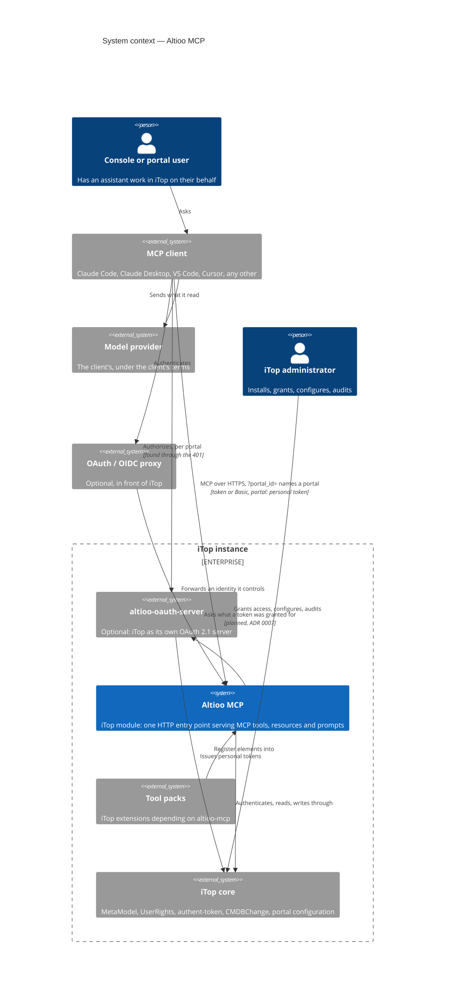

# Architecture — system context

Level 1 of the [C4 model](https://c4model.com/): who and what Altioo MCP deals with, and nothing
inside it. It is for whoever has to place the module in an estate — an approver, an operator, a
contributor seeing it for the first time — before reading the README's reasons for that shape,
in [Why it runs inside iTop](../README.md#why-it-runs-inside-itop).

The diagram names things and points; it does not describe them. Every fact behind a box or an
arrow has its home in a file linked under it, and that file wins when the two disagree.

## Reading it

- **No arrow from Altioo MCP leaves the iTop instance.** Its only outgoing arrows end at iTop
  core and at altioo-oauth-server, both inside the boundary, because the module opens no
  outbound connection ([README, Data flow and privacy](../README.md#data-flow-and-privacy)). The
  one to the OAuth server is planned, not built
  ([ADR 0007](adr/0007-the-connection-names-its-portal.md)). The arrow to the model provider
  starts at the client, and what crosses it is out of this module's reach
  ([SECURITY.md, Threat model](../SECURITY.md#threat-model), "What is out of scope").
- **The client authenticates as an iTop user**, by token, Basic authentication or a proxy in
  `external` mode, and portal mode narrows that to a personal token. Which credential is
  accepted where is in [README, Granting access](../README.md#granting-access).
- **Altioo MCP has no store and no identity of its own.** Accounts, tokens, profiles, rights,
  the datamodel and the change log are iTop core's; the one table the module adds is in
  [README, What the install changes](../README.md#what-the-install-changes).
- **The user is one person in one of two modes.** A console user is served through `UserRights`;
  a portal-only user through what their portal offers, one portal per connection, which the URL
  may name ([ADR 0006](adr/0006-one-tool-surface-the-portal-is-a-policy.md),
  [ADR 0007](adr/0007-the-connection-names-its-portal.md)).
- **The two optional boxes are alternatives** for a client that can only "Connect": the proxy
  must map identity, never pass the upstream token through, and the OAuth server is an
  optional dependency, whose consent names the portal when the URL does
  ([README, Endpoint](../README.md#endpoint);
  [ADR 0003](adr/0003-optional-dependency-on-altioo-oauth-server.md),
  [ADR 0007](adr/0007-the-connection-names-its-portal.md)).
- **Tool packs run inside the same boundary, with the caller's rights**
  ([doc/extending.md](extending.md)).

## What it leaves out

- **Containers and components** — the endpoint, the policy layer, the element registry. The code
  under `src/` is the reference until a level-2 diagram earns its place here.
- **Deployment** — the web server, the `.htaccess` / `web.config` pair, the compiled
  `env-production/` copy: [README, Endpoint](../README.md#endpoint) and
  [SECURITY.md, Hardening the deployment](../SECURITY.md#hardening-the-deployment).
- **Repository tooling** — CI, the local runner, the proposed agent evaluation harness
  ([ADR 0008](adr/0008-agent-behaviour-is-tested-with-a-model.md)). None of it is part of an
  installed instance.

## Keeping it true

Change the diagram in the same pull request as the change that alters it: a new kind of client
credential, a new optional dependency, a new actor, or the planned check landing. **An arrow
from Altioo MCP that leaves the iTop boundary is the one change that would make the README's
privacy section false**, so a pull request adding one fixes both, and says so in its
description.
